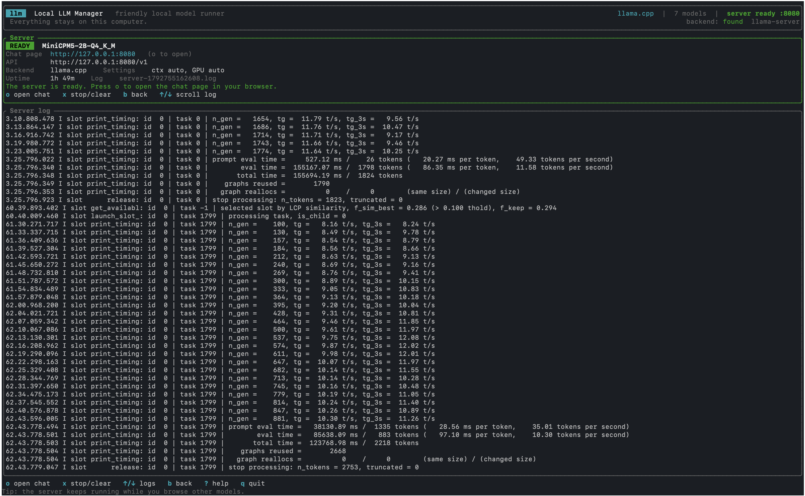

# LLM

> LLM (`llm`, Local LLM Manager), a TUI for setting up a local LLM service (via `llama.cpp` or `vLLM`).



## What it does

`llm` finds the models you already have on disk, lets you tune how they run, and starts a
local OpenAI-compatible server for you. It is a supervisor and a friendly front end — the
inference itself is done by `llama.cpp` or `vLLM`.

- **Discovers models** in the folders used by Ollama, LM Studio, llama.cpp and `~/models`,
  reading GGUF metadata to show size, parameter count, quantization and native context.
- **Configures them** with plain-language settings, grouped presets and per-model memory.
- **Launches and supervises** the server, streams its log, detects when it is ready, and
  shuts it down when you leave.
- **Stays local.** Nothing is uploaded; models and prompts stay on your computer.

## Requirements

You need one of the two runtimes installed; `llm` does not bundle them.

| Backend | Best for | Install |
| --- | --- | --- |
| `llama.cpp` (default) | `.gguf` files, CPU or GPU, single machine | `brew install llama.cpp` （on macOS） |
| `vLLM` | Hugging Face model folders on NVIDIA GPUs | `pip install vllm` |

If the binary is not on your `PATH`, set its full path in Settings (`s`) — for example
`/opt/homebrew/bin/llama-server`, or the `vllm` inside a specific virtualenv.

## Install

Prebuilt binaries for Linux (x86_64, static), macOS (Apple Silicon and Intel) and Windows
(x64) are attached to each GitHub Release, published automatically when a `v*` tag is pushed.

From source:

```bash
cargo build --release   # -> target/release/llm
cargo install --path .  # -> ~/.cargo/bin/llm
```

## Quick start

```bash
llm                 # open the TUI
llm --list-models   # just print what was found, then exit
```

Then, inside the TUI:

1. Select a model with <kbd>↑</kbd>/<kbd>↓</kbd> and press <kbd>Enter</kbd> to review settings.
2. Press <kbd>L</kbd> to launch. A toast tells you when the server is ready.
3. Press <kbd>o</kbd> to open the chat page (llama.cpp) or the API docs (vLLM) in your browser.
4. Press <kbd>x</kbd> to stop the server, <kbd>q</kbd> to quit `llm`.

Leaving the monitor with <kbd>b</kbd> keeps the server running so you can browse other models;
select that same model and press <kbd>Enter</kbd> to read its log again. The footer says
`Enter configure` or `Enter view log` depending on which row you are on.

## Command line

```
Usage: llm [OPTIONS]

Options:
      --models-dir <DIR>   Add a folder to search for models
      --backend <BACKEND>  Backend to use: llama.cpp or vllm
      --list-models        List found models and exit
      --no-mouse           Do not capture the mouse
  -h, --help               Print help
  -V, --version            Print version
```

`--backend` also accepts `llamacpp`, `llama`, `llama-cpp`, `v-llm`. Command-line options
override the saved config for that run only.

## Model discovery

The scan covers these roots (deduplicated, searched recursively up to 8 levels):

| Location | Notes |
| --- | --- |
| `--models-dir` / config `models_dir` | Your extra folder; `~` is expanded |
| `LLM_MODELS_DIR` | Environment variable |
| `./models` and `~/models` | Conventional folders |
| `~/.cache/llama.cpp` | llama.cpp only |
| `~/.ollama/models`, `$OLLAMA_MODELS` | llama.cpp only; resolves Ollama manifests to blobs |
| `~/.lmstudio/models`, `~/.cache/lm-studio/models`, `~/Library/Application Support/LM Studio/models` | LM Studio |

- **llama.cpp** collects `.gguf` files. Vision projectors (`*mmproj*`) and later shards of a
  split model (`-00002-of-00003`) are skipped; unreadable files are reported as scan notes.
- **vLLM** collects directories that contain a `config.json`, i.e. Hugging Face model folders.

Press <kbd>d</kbd> on the models screen to open Hugging Face and download a model, then
<kbd>r</kbd> to rescan.

## Using the TUI

There are four screens. <kbd>?</kbd> opens the built-in help anywhere.

### Models

| Key | Action |
| --- | --- |
| <kbd>↑</kbd>/<kbd>↓</kbd>, <kbd>j</kbd>/<kbd>k</kbd> | Move (mouse wheel works too) |
| <kbd>PgUp</kbd>/<kbd>PgDn</kbd> | Jump 10 models |
| <kbd>g</kbd>/<kbd>G</kbd> | First / last model |
| <kbd>Enter</kbd> | Configure the selected model — or, if its server is running, show that server's log |
| <kbd>L</kbd> | Launch the server with these settings |
| <kbd>s</kbd> | Settings |
| <kbd>r</kbd> | Rescan for models |
| <kbd>o</kbd> | Open the models folder |
| <kbd>d</kbd> | Open the download page |
| <kbd>q</kbd>, <kbd>Ctrl</kbd>+<kbd>C</kbd> | Quit |

### Configure

Settings are split into three tabs — **Basics**, **Performance**, **Advanced** — switch with
<kbd>Tab</kbd> or <kbd>1</kbd>/<kbd>2</kbd>/<kbd>3</kbd>. Every row shows its value, a one-line
explanation and the recommended value.

| Key | Action |
| --- | --- |
| <kbd>←</kbd>/<kbd>→</kbd> | Step the value, toggle it, or cycle its options |
| <kbd>Enter</kbd> | Type an exact value, or apply the row |
| <kbd>Esc</kbd> | Back to the list (changes are saved) |
| <kbd>c</kbd> | Show the exact command line that will be run |
| <kbd>L</kbd> | Launch |

Numbers and text open an inline editor: <kbd>Enter</kbd> commits, <kbd>Esc</kbd> cancels,
<kbd>Ctrl</kbd>+<kbd>U</kbd> clears. Fields that accept it also understand `auto`, `default`
and `all` — for example GPU layers `all`, or context `auto` to use the model's own limit.
The command preview needs a terminal at least 18 lines tall in its main area.

### Running

Shows the status, endpoints, uptime and the live server log (ANSI stripped, tail of the last
32 KB). The log is also written to disk.

| Key | Action |
| --- | --- |
| <kbd>o</kbd> | Open the chat page / API docs |
| <kbd>x</kbd> | Stop the server, or clear a finished session |
| <kbd>b</kbd>, <kbd>Esc</kbd> | Back to the model list; the server keeps running |

Returning from the model list is <kbd>Enter</kbd> on the model that is serving — its footer row
reads `view log` at that moment. <kbd>x</kbd> is only available here, so if you leave a healthy
server with <kbd>b</kbd> you can come back for it rather than restarting it with <kbd>L</kbd>.
| <kbd>↑</kbd>/<kbd>↓</kbd> | Scroll the log; <kbd>G</kbd> returns to the live tail |

### Settings

Backend, extra models folder, llama-server path, vLLM path, rescan, open config folder,
open models folder. <kbd>←</kbd>/<kbd>→</kbd> switches backend, <kbd>Enter</kbd> edits or runs
the row, <kbd>Esc</kbd> saves and returns. Changing the backend while a server is running is
refused — stop it first.

## Presets and settings

<kbd>←</kbd>/<kbd>→</kbd> on the **Preset** row applies a ready-made combination:

| Preset | Context | Notes |
| --- | --- | --- |
| Balanced (default) | auto | A safe starting point for almost any model |
| Fast & light | 4 K | Shorter replies, batch 1024/256 |
| Best quality | 16 K | Full GPU offload, temperature 0.6 |
| Long documents | 32 K | Full GPU offload, large context |

Presets never touch `Host`, `Port` or `Extra arguments`. Editing any single setting moves you
to **Custom**, and `llm` keeps a separate copy of the settings for each model path — so a
small chat model and a large coding model do not overwrite each other.

Beyond the basics, `llm` drives reasoning effort and reasoning budget, flash attention, GPU
layer offload, batching, parallel requests, `mlock`, embedded chat templates, and speculative
decoding (draft model, MTP, DFlash, DSpark, or N-gram with no extra model — vLLM supports the
draft-model path only). Anything not covered belongs in **Extra arguments**, which is split
like a shell line and supports quotes.

Values are clamped to sane ranges on load and before launch, so an out-of-range setting will
not produce a broken server.

## Using the running server

The Running screen prints both endpoints. With llama.cpp on the default port:

```bash
curl http://127.0.0.1:8080/v1/chat/completions \
  -H "Content-Type: application/json" \
  -d '{"messages": [{"role": "user", "content": "Hello"}]}'
```

Any OpenAI-compatible client works — set the base URL to `http://127.0.0.1:<port>/v1`. No API
key is needed locally, so most clients want a placeholder such as `LLM_LOCAL`.

Host defaults to `127.0.0.1`, keeping the server private to your machine. Use `0.0.0.0` only
if you deliberately want to share it on your network — `llm` adds no authentication. If your
chosen port is already taken, `llm` starts on the next free one and tells you.

## Files

| Path | Contents |
| --- | --- |
| `<config>/llm/config.toml` | Backend, binary paths, models folder, global and per-model settings |
| `<config>/llm/logs/server-<timestamp>.log` | Full output of each server run |

`<config>` is `~/Library/Application Support` on macOS, `~/.config` on Linux and
`%APPDATA%` on Windows. Settings are written when you leave a screen or quit, so the file is
safe to edit by hand — an unparseable config falls back to defaults with a warning instead of
failing. Invalid values are corrected on load.

Quitting `llm` stops the server it started (the whole process group on Unix), so no orphaned
`llama-server` keeps your GPU busy. If a model fails to load, lower the context first and set
GPU layers back to `Auto`.

## License

MIT — see [LICENSE](LICENSE).
